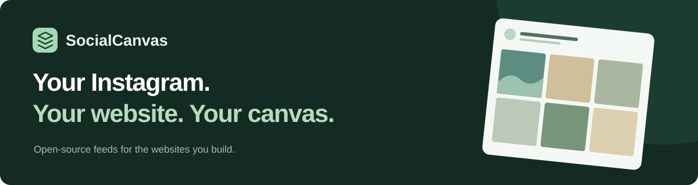
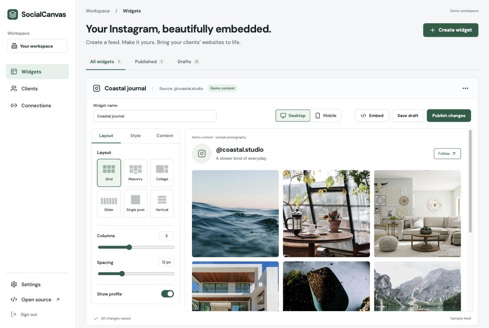
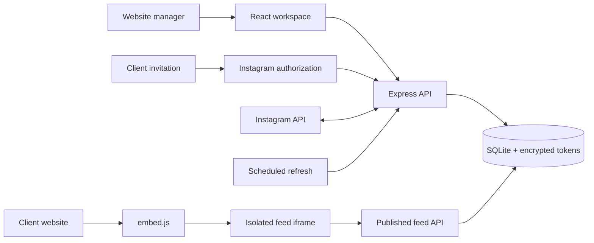

<div align="center">



# Instagram belongs on your website.

**Beautiful feeds. Private client connections. One small embed.**

SocialCanvas is an open-source Instagram widget builder for freelancers, agencies, and the clients they build for. Send a connection link, design the feed, and make it part of the website.

[](https://github.com/RaDeleon/SocialCanvas/actions/workflows/ci.yml)
[](LICENSE)
[](https://github.com/RaDeleon/SocialCanvas/stargazers)
[](https://github.com/RaDeleon/SocialCanvas/forks)
[](https://github.com/RaDeleon/SocialCanvas/issues)

[](package.json)
[](#six-layouts-one-canvas)
[](#where-the-beta-stands)
[](https://github.com/RaDeleon/SocialCanvas/commits/codex/managed-beta)

[Get started](#running-in-two-commands) · [See the app](#meet-your-new-workspace) · [Instagram setup](docs/instagram-setup.md) · [Self-host](docs/self-hosting.md#production) · [Contribute](CONTRIBUTING.md)


</div>

> [!IMPORTANT]
> **Managed beta.** The local demo works without Instagram credentials. Real connections require a configured Meta app, an eligible Business or Creator account, and the access approval appropriate to your use. Hosted billing and public self-service signup are planned, not shipped.

## Meet your new workspace

A visual builder where your preview and published embed use the same feed renderer. Change the layout, set the spacing, hide a post, and publish when it feels right.



_Actual application screenshot with clearly labeled sample photography. No live Instagram account is represented._

## Built for the person managing the website

Your client should connect their account. You should get on with building their website.

| For your client                         | For you                                              |
| :-------------------------------------- | :--------------------------------------------------- |
| A private invitation link               | One workspace for clients, connections, and widgets  |
| Instagram authorization through Meta    | A visual editor with desktop and mobile controls     |
| No SocialCanvas account to create       | Drafts you can refine before publishing              |
| No Instagram password to share          | An embed snippet you can install yourself            |
| Account removal and data deletion paths | Refresh status, reconnect links, and domain controls |

```text
Add client → Send private link → Client connects Instagram
                                      ↓
                          Design → Publish → Embed
```

### Six layouts. One canvas.

| Layout          | Make it work for                                            |
| :-------------- | :---------------------------------------------------------- |
| **Grid**        | Clean galleries, homepage feeds, and consistent photo tiles |
| **Masonry**     | Images in their natural proportions, arranged in columns    |
| **Collage**     | A featured moment surrounded by smaller tiles               |
| **Slider**      | Horizontal galleries with touch scrolling and navigation    |
| **Single post** | A compact spotlight with previous/next navigation           |
| **Vertical**    | Stacked feeds for sidebars and editorial pages              |

Fine-tune columns, mobile columns, spacing, rounded corners, accent colors, light/dark themes, and photo tiles or classic cards. Add a profile header and captions, filter by media type, and choose which posts appear. Open posts in a lightbox or on Instagram; play videos and browse carousel media when the connected account supplies them.

### Small embed. Real control.

```html
<div data-socialcanvas="YOUR_WIDGET_ID"></div>
<script src="https://YOUR_SOCIALCANVAS_DOMAIN/embed.js" async></script>
```

- **Publish deliberately.** Saved drafts stay separate from published layout and domain settings.
- **Fit the page.** The script creates an iframe and adjusts its height as content changes.
- **Choose the websites.** Published iframe responses restrict framing to configured domains.
- **Keep content fresh.** Live accounts refresh approximately hourly while the server is running.
- **Keep the feed focused.** No analytics or advertising scripts are bundled into the embed.

Paste it into an HTML block on your website. WordPress, Webflow, Squarespace, Shopify, and other builders can use the snippet where their plan, security settings, and theme allow scripts and iframes. Native platform plugins are not included.

## Running in two commands

Requires **Node.js 22.13+** and npm.

```sh
git clone https://github.com/RaDeleon/SocialCanvas.git
cd SocialCanvas
# Until the beta PR is merged, check out its implementation branch:
git switch codex/managed-beta
npm ci
npm run dev
```

Open **[localhost:5173](http://localhost:5173)** and choose **Open demo workspace**. Explore the layouts, create a client invitation, connect a demo account, and publish a sample feed. The local demo password is `socialcanvas-demo`.

<details>
<summary><strong>What the demo does—and where your data goes</strong></summary>

The demo uses sample photography, not a live Instagram account. Its connection page clearly separates the demo action from Instagram authorization. Data persists in `data/socialcanvas.sqlite`; the database, dependencies, build output, and local secrets are ignored by git.

Development binds to loopback. `.env` is optional for the default local demo. If you copy `.env.example`, fill in the password and encryption key: blank values override the development defaults.

Node's built-in SQLite is currently experimental. It keeps this beta's persistence small and avoids a separate database service.

</details>

## From first invitation to client website

1. **Add the client.** Enter their name and website.
2. **Generate a connection link.** Invitations expire after 72 hours and work once. Replacement links revoke previous unused invitations.
3. **Send it yourself.** Use your normal client communication channel; email delivery is not built in.
4. **Let the client authorize.** They connect an eligible Instagram account through Meta.
5. **Create the widget.** Choose a layout, style the feed, and save your draft.
6. **Set the allowed domains.** Include `www` separately if the website uses it.
7. **Publish and install.** Copy the embed code into the client website.

**Ready for a real account?** Follow the [Instagram setup guide](docs/instagram-setup.md), then validate the entire flow with an approved test account before inviting clients.

## Open source. Your infrastructure or a managed service.

SocialCanvas is designed for both self-hosting and a paid hosted service using the same codebase. This release delivers the managed-client workflow; it does not include subscriptions, plan metering, or customer signup.

| Self-host                                  | Operate a managed service                                    |
| :----------------------------------------- | :----------------------------------------------------------- |
| Run the app on your own infrastructure     | Host and maintain the app for your clients                   |
| Bring your own Meta app and credentials    | Handle client setup, styling, and installation               |
| Own the persistent data volume and backups | Charge for hosting and service through your existing process |

A [Dockerfile](Dockerfile), [Compose configuration](compose.yaml), and [environment reference](.env.example) are included. Production requires HTTPS, a strong admin password, a unique encryption key, and the correct Meta configuration.

**[Read the deployment guide →](docs/self-hosting.md#production)**

## Inside SocialCanvas



| Layer                       | Stack                                                        |
| :-------------------------- | :----------------------------------------------------------- |
| **Builder & feed renderer** | React 19, TypeScript, Vite, Lucide                           |
| **Backend**                 | Node.js 22, Express 5, Zod                                   |
| **Storage**                 | SQLite with AES-256-GCM encryption for access credentials    |
| **Distribution**            | JavaScript loader + iframe, Docker, Compose                  |
| **Verification**            | Node test runner, TypeScript build, Prettier, GitHub Actions |

<details>
<summary><strong>Security and connection lifecycle</strong></summary>

- Admin sessions use HttpOnly cookies and expire after 12 hours.
- State-changing application requests use an origin check and request-verification header.
- Invitation tokens are stored as SHA-256 hashes and can be revoked.
- OAuth state is short-lived, browser-bound, and single-use.
- Instagram credentials are encrypted on the server and excluded from public feed responses.
- Live tokens are renewed before expiry; refresh errors are visible in Connections.
- Disconnecting removes the local credential and cached media.
- Signed Meta deauthorization and data-deletion callbacks verify HMAC-SHA256 signatures.
- Data deletion removes the associated client records, widgets, invitations, and account, then returns a confirmation URL.

The beta targets a single-process, single-admin deployment. Published feeds are public resources: domain controls restrict framing, not access to secret content. Media requests go to Instagram's CDN; sample photography goes to Unsplash. The website operator owns their privacy notice and any consent requirements.

</details>

<details>
<summary><strong>Project map and local commands</strong></summary>

```text
src/components/       Widget builder, shared feed, clients, invitations
src/App.tsx           Workspace, login, embed, and privacy routes
server/app.mjs        Admin/public APIs, OAuth, sync, and deletion callbacks
server/instagram.mjs  Meta API adapter
server/store.mjs      SQLite schema and credential encryption
server/*.test.mjs     Backend and adapter tests
.github/workflows/    Build, test, and formatting checks
```

```sh
npm run dev           # Local API + frontend
npm run build         # Typecheck and create production frontend
npm test              # Backend integration and Meta adapter tests
npm run format:check  # Check source formatting
npm start             # Production server; requires environment configuration
```

</details>

## Repository pulse

<div align="center">

[](https://github.com/RaDeleon/SocialCanvas)
[](https://github.com/RaDeleon/SocialCanvas)
[](https://github.com/RaDeleon/SocialCanvas/graphs/contributors)
[](https://github.com/RaDeleon/SocialCanvas/pulls)

[](https://www.star-history.com/#RaDeleon/SocialCanvas&Date)

</div>

GitHub badges track repository activity. The CI and last-commit badges above track the beta implementation branch. The star-history chart fills in as the project gains stars; external badge/chart providers can occasionally be unavailable.

## Where the beta stands

| Available now                                           | Still ahead                                                  |
| :------------------------------------------------------ | :----------------------------------------------------------- |
| Client invitations and direct Instagram Login connector | Live-account acceptance testing and required Meta approval   |
| Six layouts and a shared preview/embed renderer         | More templates and platform-specific install tooling         |
| Drafts, publishing, moderation, and domain controls     | Self-service signup, checkout, and plan metering             |
| Approximately hourly sync and latest 100 media items    | Historical pagination and additional content-source adapters |
| Local demo, Docker packaging, and automated tests       | Public hosted service launch                                 |

Personal-account feeds, arbitrary public usernames, hashtag discovery, Stories, live streams, and live like/comment counts are outside this beta. The current connector uses Instagram Login, not Unified Login. A passing build and mocked API tests do not establish live Meta compatibility or approval.

## Build with us

Found a broken layout? Have a website builder we should support better? [Open an issue](https://github.com/RaDeleon/SocialCanvas/issues) with a reproducible example, or read the [contributing guide](CONTRIBUTING.md) and send a focused pull request.

If SocialCanvas fits your workflow, **[give it a star](https://github.com/RaDeleon/SocialCanvas/stargazers)** so more website builders can find it.

---

<div align="center">

**Your content. Your clients. Your canvas.**

[AGPL-3.0](LICENSE) · [Source code](https://github.com/RaDeleon/SocialCanvas) · [Report a bug](https://github.com/RaDeleon/SocialCanvas/issues) · [Instagram setup](docs/instagram-setup.md)

</div>

The existing AGPL-3.0 license is preserved. Set `SOURCE_URL` to the corresponding source for your running version when hosting a modified build.
